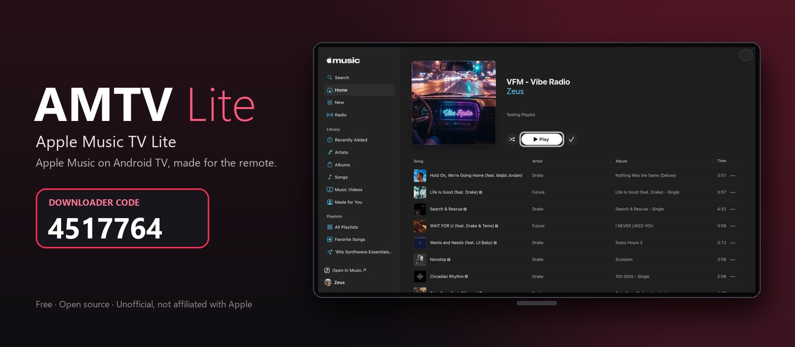

  

  
  
  
  
  
  

<table align="center">
  <tr>
    <th>📺 On your TV</th>
    <th>💻 On a computer</th>
  </tr>
  <tr>
    <td align="center">Open the <b>Downloader</b> app and enter <h3><code>4517764</code></h3></td>
    <td align="center"><a href="https://github.com/zeusserverr/amtv-lite/releases/latest/download/AMTV-Lite.apk"><b>⬇️ Download the APK</b></a>  then <code>adb install AMTV-Lite.apk</code></td>
  </tr>
</table>

---

## What it is

**AMTV Lite (Apple Music TV Lite) is the real Apple Music, on Android TV.** This isn't a look-alike or a third-party player. It's Apple's own web player (music.apple.com) running inside a browser we built for the TV. You get your library, playlists, radio, lyrics and Apple's whole catalog, exactly as Apple serves them, and you control all of it with the TV remote.

> Unofficial and not affiliated with Apple. You sign in with your own Apple ID and Apple Music subscription.

## Why not the alternatives?

| Option | The catch |
|---|---|
| Official Apple Music app for Android TV | Not offered on many devices; the NVIDIA SHIELD gets "Your device isn't compatible" |
| Sideloading the phone app | A touch-screen app: hard or impossible to use with a remote |
| Casting or AirPlay from a phone | Needs your phone every time, and the TV can't browse on its own |
| A regular TV web browser | Built for a mouse, not a remote; fiddly typing; a heavy page; music often stops when you switch apps |
| Unofficial Apple Music clients | Re-create Apple's service with private APIs that can break or put your account at risk |
| **AMTV Lite** | **Apple's own player, in a browser built for TVs: works with the remote, keeps playing in the background, and stays light** |

## Built as a custom TV browser

Apple's web player is designed for a computer with a mouse. Instead of re-creating Apple Music, we built a small browser around it that turns it into a TV app:

- **Remote navigation layer.** The browser reads what's clickable on Apple's page and moves a highlight between items with the arrow keys. Playlists and albums move one song per press, a newly opened page lands on its **Play** button, and OK on a song plays it.
- **TV text entry.** Its own on-screen text box types into Apple's sign-in and search fields, including Apple's sign-in frame.
- **Background music.** Playback keeps going after you press Home, with proper media-app priority, and the remote's play/pause/skip keys work from anywhere.
- **Now Playing and screensaver.** A full-screen Now Playing view, drawn by the app itself: big cover, song, progress, and a background tinted from the cover. After 2 minutes without a button press it turns into a dim, slowly drifting screensaver.
- **Quick menu and voice search.** Hold **Back** for a menu that jumps straight to Now Playing, Search, Home, New, Radio, Recently Added or Playlists. Voice search finds an artist, album or song by voice.
- **Your language.** The app's own text is in English, Spanish, French, German, Portuguese, Italian, Japanese and Russian. Apple's page follows your Apple Music settings.
- **Tuned for TV hardware.** Small scripts make Apple's page lighter. Measured on an NVIDIA SHIELD:

| | Apple's page as-is | In this app |
|---|---|---|
| Play/Shuffle → playback license | 9–20 s | ~2 s |
| Data used just opening a playlist | ~17 MB of unplayed previews | 0 |
| Page busy after opening a playlist | 15–18 s | 3–4 s |
| Audio downloaded ahead | ~5 minutes | ~90 seconds |

The technical details are in [docs/DEVELOPMENT.md](docs/DEVELOPMENT.md).

## Screenshots

<table>
  <tr>
    <td width="50%"> Moving around Home with the remote</td>
    <td width="50%"> A playlist opens with <b>Play</b> already highlighted</td>
  </tr>
  <tr>
    <td> Down moves one song at a time</td>
    <td> Playing</td>
  </tr>
</table>

▶️ **[Watch the 30-second demo](docs/demo-switch-playlists.mp4)**: switching between two playlists with the remote.

## Install

**You need:** an Android TV or Google TV device on Android 8.0 or newer, an up-to-date Android System WebView, and an Apple Music subscription.

1. On your TV, install **Downloader** (by AFTVnews) from the Play Store.
2. Let it install apps: **Settings → Apps → Special app access → Install unknown apps → Downloader**. On some TVs this is under **Device Preferences → Security & restrictions → Unknown sources**.
3. Open Downloader, enter **`4517764`**, and choose **Install** when the download finishes.
4. Open **AMTV Lite** and sign in with your Apple ID. You stay signed in.

To update, do the same again; the new version installs over the old one. Prefer a computer? [Download the APK](https://github.com/zeusserverr/amtv-lite/releases/latest/download/AMTV-Lite.apk) and run `adb install AMTV-Lite.apk`. All versions are on the [Releases page](https://github.com/zeusserverr/amtv-lite/releases), each with the APK's SHA-256 checksum so you can confirm your download is genuine.

## Remote controls

| Button | Does |
|---|---|
| Arrows | Move the highlight; in song lists, one song per press |
| OK | Select or play |
| Back | Go back, or close Now Playing / the menu; on the first page, leave with the music still playing |
| **Hold Back** | Quick menu: Now Playing, voice search, Search, Home, New, Radio, Recently Added, Playlists |
| Mic / Search button | Voice search (on remotes that send it to the app) |
| In Now Playing | OK play/pause · ◀ ▶ previous/next |
| Play/Pause, ⏭, ⏮ | Control playback from anywhere |

## FAQ

**Is signing in safe?** You sign in on Apple's own page. The app's text box passes what you type straight into Apple's field and doesn't save, log or send it anywhere else. You can check this in [`TvInput.kt`](app/src/main/java/com/ralph/applemusictv/TvInput.kt).

**Lossless or Dolby Atmos?** No. Apple's web player streams 256 kbps AAC, and that's what this app plays.

**Will it work on my TV?** Most Android TV and Google TV devices, as long as their WebView supports Widevine (Apple's copy protection). It's tested on an NVIDIA SHIELD; Amazon Fire TV is untested.

**Found a problem?** [Open an issue](https://github.com/zeusserverr/amtv-lite/issues/new/choose) with your TV model and what happened.

## Build from source

With JDK 17 and the Android SDK (platform 34) installed, run `./gradlew assembleDebug` (`gradlew.bat assembleDebug` on Windows); the right Gradle version downloads itself. Every change is also built automatically on GitHub. Release signing and the release steps are in [docs/DEVELOPMENT.md](docs/DEVELOPMENT.md). Changes are listed in the [changelog](CHANGELOG.md).

## License

[MIT](LICENSE) © zeusserverr. Apple and Apple Music are trademarks of Apple Inc.; this is an independent, unofficial project.
