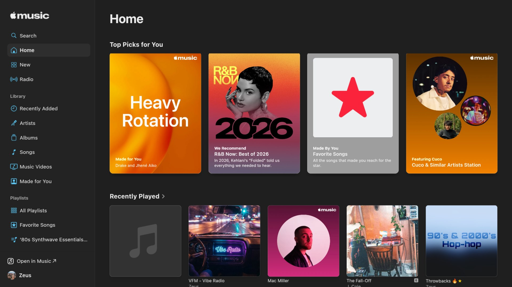
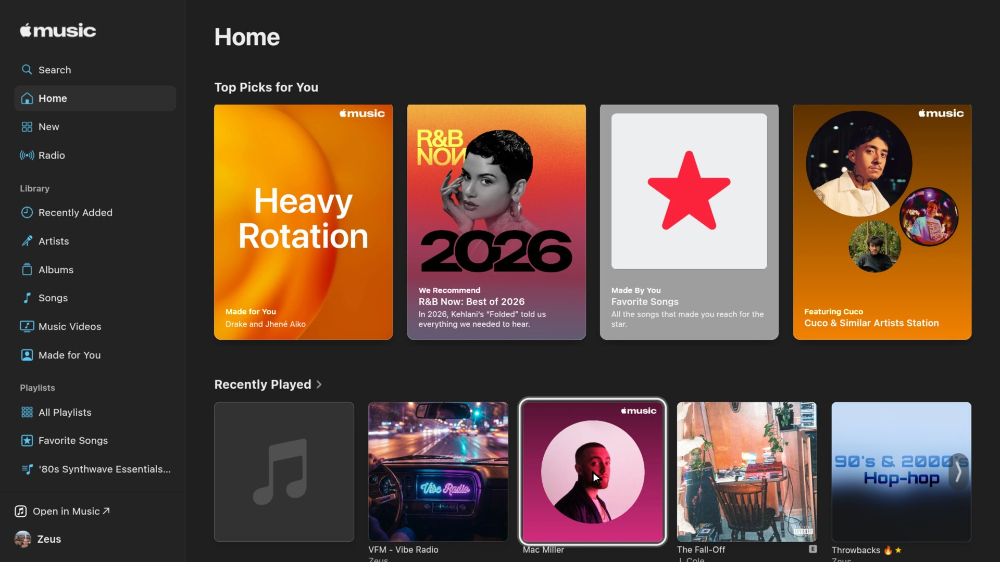
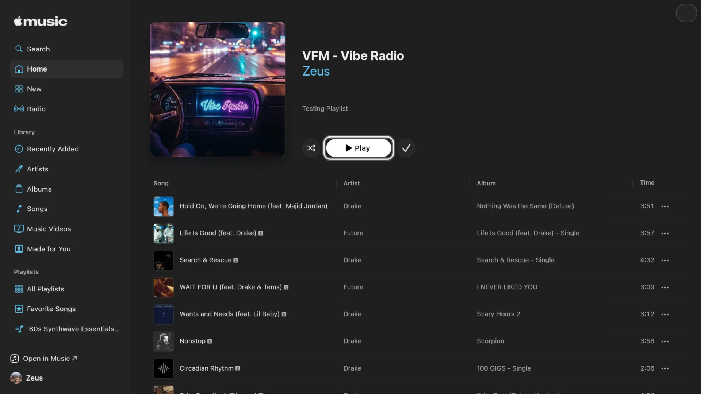
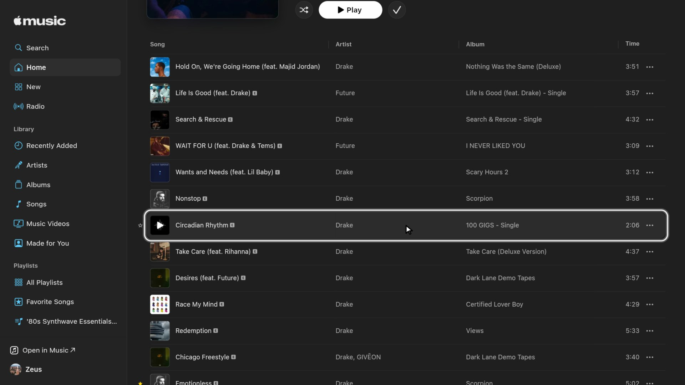

# Android Apple Music TV

**Apple Music on Android TV, driven entirely by the TV remote.**

The official Apple Music app isn't available for many Android TV devices, including the NVIDIA SHIELD ("Your device isn't compatible"). This app is a full-screen, TV-friendly window onto Apple's own web player at [music.apple.com](https://music.apple.com). Apple's player does the music, and this app makes it work from the couch: a remote-controlled pointer, song-by-song lists, on-screen text entry, and playback that keeps going after you press Home.

> **Unofficial.** Not made by, endorsed by, or affiliated with Apple. "Apple Music" is a trademark of Apple Inc. This app contains no Apple code: it opens music.apple.com, and you sign in with your own Apple ID and subscription.



## What it can do

| | |
|---|---|
| **Remote-first navigation** | The arrow keys jump between buttons, tiles and songs, with a highlight showing where you are. No mouse or touch needed. |
| **Song-by-song lists** | In playlists and albums, Up and Down move exactly one song per press while the list scrolls under a steady highlight. |
| **Lands on Play** | Open a playlist or album and the highlight moves to its **Play** button by itself. |
| **OK plays a song** | OK on a song starts it straight away (on Apple's site a single tap only selects it). |
| **Keeps playing in the background** | Press Home and the music carries on, with the right Android priority so it doesn't stutter or get closed. |
| **TV media controls** | Play/pause, next and previous on the remote work, and the song shows up in Android's media controls (and in launchers that read them). |
| **Signing in** | A native on-screen text box for Apple ID sign-in and Search, so the TV keyboard works properly. |
| **Player bar only when needed** | Apple's floating player bar hides when nothing is playing, so it doesn't cover pages. |

### Made lighter for TV hardware
Measured on an NVIDIA SHIELD (2019):
- **Much faster to start:** after Play or Shuffle, Apple's playback license arrives in about 2 seconds instead of 9–20. Apple's DRM certificate is kept on the device instead of being downloaded again for every song. The very first song after the app opens can still take a few seconds longer.
- **No wasted downloads:** Apple's page used to download six 30-second song previews (about 17 MB) every time a playlist opened. They now load only if you play one.
- **About 5 times less busy after opening a playlist** (3–4 s instead of 15–18 s), so the remote stays responsive.
- **Less audio downloaded ahead:** the app holds Apple's player to about 90 seconds ahead instead of about 5 minutes, so skipping songs wastes less data.
- **Lighter page:** off-screen song rows skip styling and layout, animated cover videos and blur effects are turned off, and hover effects are sent only when the pointer rests.

## Screenshots

| | |
|---|---|
|  |  |
| Moving around Home with the remote | A playlist opens with **Play** already highlighted |
|  |  |
| Down moves one song at a time | Playing, with Apple's player bar |

**Video (30 s):** [switching between two playlists with the remote](docs/demo-switch-playlists.mp4)

## Requirements
- An Android TV device running **Android 8.0 or newer** (tested on an NVIDIA SHIELD, Android 11).
- **Android System WebView** up to date (from the Play Store), since Apple's web player needs a recent Chrome engine.
- An **Apple Music subscription** and Apple ID.
- A TV remote (a game controller works too).

## Install
1. Download the latest `.apk` from this repository's **Releases** page.
2. Get it onto your TV, either:
   - with the **Downloader** app on the TV (enter the APK's download link), or
   - from a computer: `adb install AndroidAppleMusicTV.apk`
3. Allow installs from that app when Android asks ("Install unknown apps").
4. Open **Android Apple Music TV**, choose **Sign In** on Apple's page and sign in with your Apple ID using the on-screen text box.

Your sign-in is kept, so this is a one-time step.

## Using it

| Remote | What it does |
|---|---|
| **Arrows** | Move between items; in song lists, one song per press |
| **Hold an arrow** | Keep moving; where there's nothing to jump to, the pointer glides freely |
| **OK** | Select / play |
| **Back** | Go back a page; on the first page, leave the app with the music still playing |
| **Home** | Back to your launcher; the music keeps playing |
| **Play/Pause, ⏭, ⏮** | Control playback from anywhere |

## Known limits
- **It's Apple's web player.** What music.apple.com supports is what you get: 256 kbps AAC, no Lossless or Dolby Atmos (the web player doesn't offer them), and it depends on Apple not changing their website in ways that break it.
- **Playback uses about half of one CPU core** (on a SHIELD), mostly Android's protected-audio decoding, which the app can't change.
- **Some devices may not play protected audio.** Apple's player needs Widevine DRM in the system WebView. Most Google TV / Android TV devices have it; Amazon Fire TV is untested.
- **Text entry** goes through a native box at the top of the screen rather than Apple's own fields.

## Building from source
Requirements: JDK 17, Android SDK (platform 34), Gradle 8.7.

```bash
gradle assembleDebug        # debug build: app/build/outputs/apk/debug/app-debug.apk
gradle assembleRelease      # release build (see "Signing" below)
```

**Signing:** release builds are signed with a key you provide in `~/.gradle/gradle.properties`:

```properties
AMTV_STORE_FILE=C:/path/to/release.keystore
AMTV_STORE_PASSWORD=...
AMTV_KEY_ALIAS=...
AMTV_KEY_PASSWORD=...
```

Keep that keystore safe. Updates must be signed with the same key, or Android refuses to install them over the old version.

## How it works
- A full-screen Android `WebView` loads music.apple.com with a desktop browser identity (so Apple serves the full web player), laid out about 1400 CSS pixels wide so it reads well on a TV.
- **Remote navigation:** the app reads the page's clickable items, picks the best one in the arrow's direction, and moves a highlight there. Clicks are sent as taps. In song lists, the page itself finds the next or previous song and scrolls it into place.
- **Widevine** is allowed for apple.com only. A foreground media service keeps playback alive in the background.
- **Lightness work** is done with small scripts injected at page start: the preview, cover and player-bar fixes listed above. The DRM certificate is served from the device via `shouldInterceptRequest`.
- Developer notes, measurements and history are in [HANDOFF.md](HANDOFF.md).
